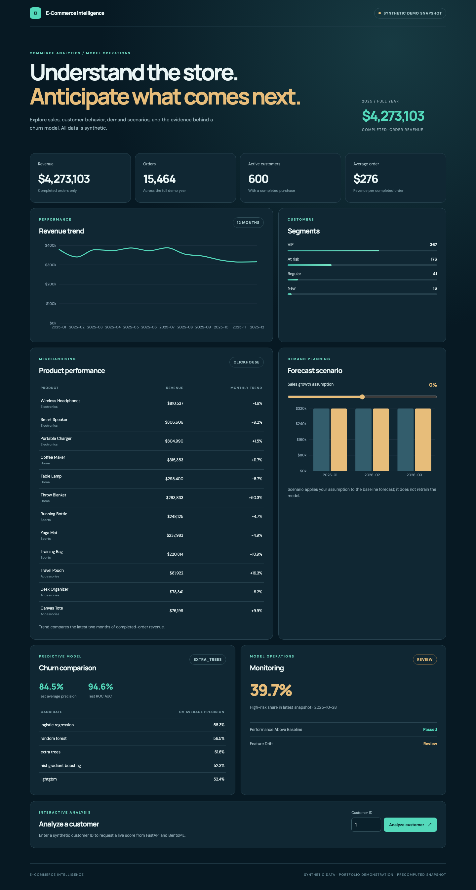

# E-Commerce Intelligence Platform

[](https://github.com/DanyloKuryliak/ecommerce-intelligence-platform/actions/workflows/ci.yml)

A portfolio project exploring how an online store can turn order history into business analytics, forecasts, and churn risk scores. It uses deterministic synthetic data, so no real customer information is involved. Databases, orchestration, model training, experiment tracking, and prediction serving run locally; the frontend can also be built as a static demo.



## What I built

- A repeatable data pipeline that generates customer, product, and order CSVs, checks their quality, then loads them into PostgreSQL.
- A ClickHouse analytical copy with reconciled order counts and revenue, powering named-product performance and monthly trend reporting.
- Time-aware churn model selection across five model families, with randomized tuning, walk-forward cross-validation, a later untouched test snapshot, and an MLflow run.
- A BentoML scoring service called by a FastAPI business API, with customer-level feature assembly and human-readable risk reasons.
- A locally orchestrated Airflow workflow, three-month demand baseline, batch monitoring, and a growth what-if control.
- A responsive Next.js and Recharts dashboard, plus an aggregate-only JSON snapshot for a static public demo.

```text
Synthetic CSV → quality gate → PostgreSQL ──→ customer segments + monthly sales
                                  │
                                  ├──→ ClickHouse → product performance
                                  └──→ LightGBM and other churn candidates → MLflow
                                                 │
                                                 └──→ BentoML → FastAPI → Next.js + Recharts
Airflow orchestrates the local refresh; demand forecasts and monitoring feed the same dashboard.
```

## What you can explore

- Completed-order revenue, orders, active customers, monthly trend, and customer segments.
- Twelve named products with revenue and month-over-month change from ClickHouse.
- Churn-model comparison, time-aware cross-validation, held-out test metrics, monitoring checks, and a live customer score routed through BentoML.
- A three-month revenue forecast and transparent growth what-if slider. The forecast is a baseline, **not** an optimized production model.

All values and people are simulated. Model scores demonstrate an engineering workflow, not business advice or a guarantee on real customers.

Latest verified local run (2026-10-08): 600 customers, 16,452 generated order lines, 15,464 completed orders, and $4.27M completed-order revenue matched across PostgreSQL and ClickHouse. Five churn model families were compared; Extra Trees won on cross-validation and scored 0.845 test average precision versus a 0.338 positive-rate baseline (test ROC AUC 0.946). The demand baseline had 14.0% holdout MAPE; monitoring reported `review`, which is shown rather than hidden. These numbers describe only this deterministic synthetic dataset.

## Technology stack

| Area | Tools |
| --- | --- |
| Data store and analytics | PostgreSQL, ClickHouse |
| Orchestration | Apache Airflow |
| Modeling and tracking | Python, scikit-learn, LightGBM, MLflow |
| Prediction serving | BentoML, FastAPI |
| Dashboard | Next.js, React, TypeScript, Recharts |
| Local environment | Docker Compose, `uv`, npm |

## Run locally

Prerequisites: Docker Desktop, `uv`, Node.js/npm. The commands are documented so the system can be reproduced; the coding agent can run them for you.

```bash
cp .env.example .env
make setup
make data
make db-up
make ml
make airflow-up
make demo-snapshot
make test
```

`make ml` loads the data, builds analytics and the ClickHouse copy, trains/evaluates churn and demand, logs an MLflow run, and writes monitoring results. `make airflow-up` starts the local orchestration and MLflow UI; trigger the `ecommerce_intelligence_refresh` DAG at `http://127.0.0.1:8080` to rehearse the complete workflow. The DAG has a weekly schedule but starts paused, so Docker cannot silently overwrite a local run. Unpause it in Airflow only when you want automatic weekly refreshes.

For the live local site, start these in separate terminals:

```bash
make run-bento
make run-api
cd frontend && npm ci && npm run dev
```

Open `http://127.0.0.1:3000`. Local endpoints: FastAPI `:8001`, BentoML `:3001`, MLflow `:5000`, Airflow `:8080`, PostgreSQL `:5433`, ClickHouse HTTP `:8123`. The frontend falls back to checked-in aggregate demo data if the local API is absent; live customer scoring requires all local services. To stop containers, `make db-down` (include `--profile orchestration` in Compose if you also started Airflow/MLflow).

## Code tour

| Folder | Role |
| --- | --- |
| `pipeline/`, `db/` | Generate, validate and load CSV; refresh PostgreSQL and ClickHouse. |
| `ml/` | Point-in-time training, forecasting and model monitoring. |
| `orchestration/` | Airflow DAG connecting the local stages. |
| `serving/`, `api/` | BentoML prediction service and FastAPI business endpoints. |
| `frontend/` | Next.js/Recharts dashboard and browser tests. |
| `web/demo-data.json` | Exported, aggregate-only public-demo snapshot. |
| `infra/`, `docs/` | Docker services and architecture/release details. |

Start reading at [the architecture guide](docs/ARCHITECTURE.md), then follow `pipeline/generate_demo_data.py` → `pipeline/load_demo_data.py` → `pipeline/sync_clickhouse.py` → `ml/churn_model.py` → `serving/service.py` → `api/app/main.py` → `frontend/app/dashboard.tsx`.

## Verification and publication

```bash
make test
cd frontend && npm run typecheck && npm run build && npm run test:e2e
```

The frontend's `out/` directory is the static site build. This repository contains the project and its source; **the site itself has not been deployed**. See [the release runbook](docs/DEPLOYMENT.md). Raw generated customer/order rows, credentials, and model weights are excluded from Git. The original static `web/index.html` remains as a legacy API-root view; Next.js is the primary UI.
